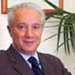

## Equipo actual

::: {.equipo}

::: {.persona}
{fig-alt="Foto de Ulises Beltrán"}

**Ulises Beltrán** BGC [bgc.com.mx](https://www.bgc.com.mx/)
:::

::: {.persona}
{fig-alt="Foto de Rodrigo Castro Cornejo"}

**Rodrigo Castro Cornejo** UMass Lowell · Center for Public Opinion [Sitio personal](https://www.rodrigocastrocornejo.com/)
:::

::: {.persona}
{fig-alt="Foto de Melina Altamirano"}

**Melina Altamirano** El Colegio de México · Centro de Estudios Internacionales [Sitio personal](https://melinaaltamirano.com/)
:::

::: {.persona}
{fig-alt="Foto de Matthew Singer"}

**Matthew Singer** University of Connecticut · Ciencia Política [Perfil UConn](https://polisci.uconn.edu/person/matthew-singer/)
:::

:::

## Participaciones anteriores

::: {.equipo}

::: {.persona}
{fig-alt="Foto de Sandra Ley"}

**Sandra Ley** Tecnológico de Monterrey · Escuela de Ciencias Sociales y Gobierno *Participó en las ediciones 2018 y 2021* [Sitio personal](https://sandraley.net/)
:::

:::

El CIDE dirigió el diseño y levantamiento del ENEM hasta 2021. La ola 2024 la realizaron la University of Massachusetts Lowell, El Colegio de México y la University of Connecticut.
